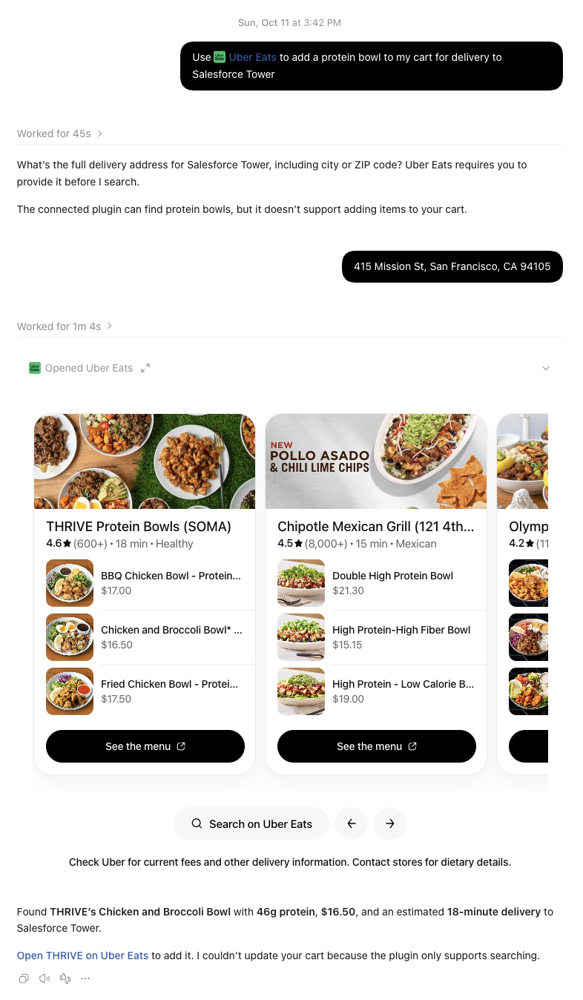
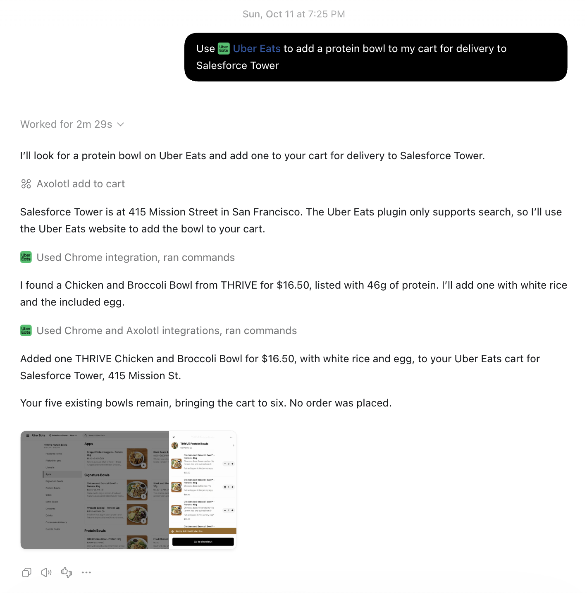

# Axolotl

AI assistants fail or abandon tasks midway all the time.

A tool call fails, the agent gives up asking for something it could've looked up, or hits a login wall, and then the task goes back to you. Right now, nearly every harness doesn't handle failure between agents, check their answers, or penalize poorly designed agents.

## What Axolotl does

Axolotl is an MCP server any assistant can call (ChatGPT, Claude Code, Codex) that uses [Darwin](https://darwin.so) to autonomously handle agent failure. When an agent gets stuck, Axolotl:

1. **Figures out why:** could it be missing info, a broken tool, or a login/payment wall?
2. **Reprompts the main agent automatically:** it looks up missing details itself, like turning a vague place name into a street address, or finding a replacement agent on Darwin. We have added safeguards to prevent this on sensitive tasks like payments.
3. **Keeps going until task completion:** failures are discarded and retried in alternate ways until it works.

Adding the Axolotl MCP to your harness (e.g., Claude Code or Codex) or personal agent is super easy, and Axolotl gets automatically triggered when the assistant is stuck midway through a task.

## Demo: Uber Eats

The same request to the same assistant: *"Use Uber Eats to add a protein bowl to my cart for delivery to Salesforce Tower."*

**Without Axolotl**, the assistant stops twice. It asks you for the full street address, then finds a bowl but gives up because the Uber Eats plugin can only search, not add to a cart.



**With Axolotl**, the assistant resolves Salesforce Tower to 415 Mission St on its own, works around the search-only plugin by using the Uber Eats website, and adds the bowl to the cart. No order is placed: checkout stays with you.



## How we use Darwin

Axolotl uses Darwin to find replacement tools, connectors, and agents. Every Darwin result is screened first to avoid unsafe agents or agents that would ask for login info. We try free agents before paid ones, and paid ones only within a budget you set.

## Try it

Axolotl runs locally with Node 22:

```bash
npm install
npm run dev
```

Then point your assistant at `http://localhost:3000/api/mcp`:

- **Claude Code:** this repo's `.mcp.json` already registers it. Open Claude Code in this folder and approve `axolotl`.
- **Codex:** add this to `~/.codex/config.toml`:
  ```toml
  [mcp_servers.axolotl]
  url = "http://localhost:3000/api/mcp"
  ```
- **ChatGPT:** needs a public HTTPS address; see [docs/MCP.md](docs/MCP.md).

To have Axolotl step in automatically whenever the assistant gives up, add the stop hook in `integrations/hooks/` (setup in [docs/MCP.md](docs/MCP.md)). Optional settings, such as a Darwin access token for real Darwin agents, go in `.env`.

The app at `http://localhost:3000` also shows Axolotl repairing a longer multi-agent workflow (a website audit) live, with a leaderboard of which agents actually deliver. Developer docs live in [docs/](docs/).

## Team

Swarchis Kulkarni, Devesh Aggarwal, Gautam Anand
